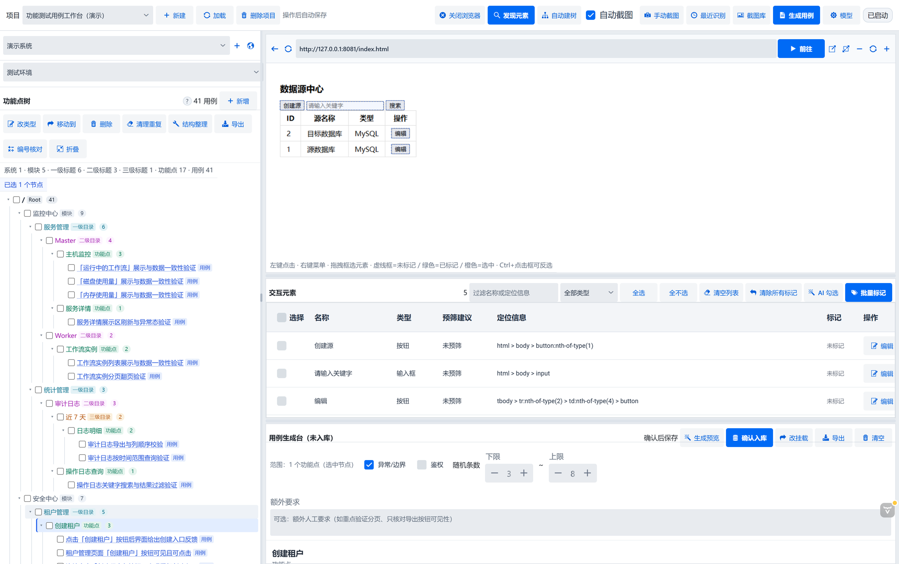
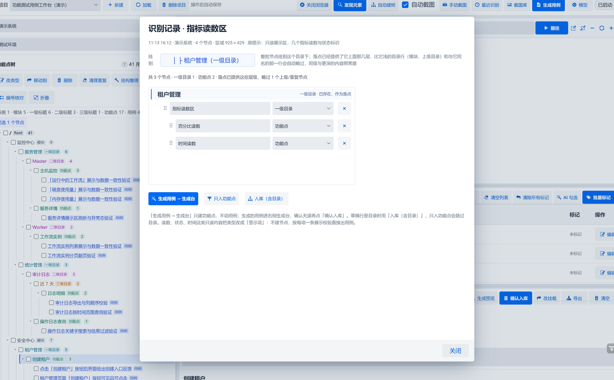
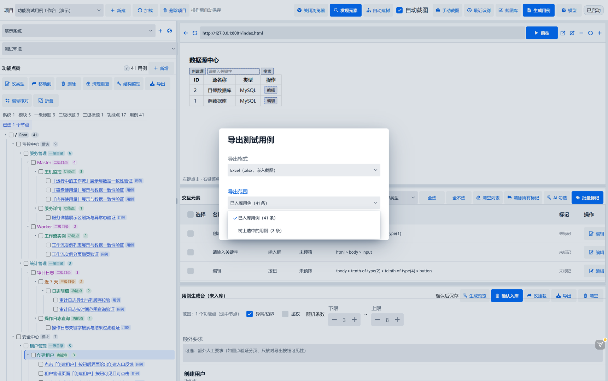

# UI Testcase Studio

> 一个本地部署的**界面功能测试用例工作台**：在同一个窗口里打开被测系统、标记界面元素、把页面结构整理成功能点树、生成测试用例，最后一键导出可以直接交付的 Excel。




---

## 它解决什么问题

做界面功能测试时，用例通常散落在 Excel、截图和脑子里：截了图不知道对应哪个页面，写了用例又要回头找元素和接口。这个工具把这几件事串在一条线上：

- **看到什么就能记什么**：浏览器镜像里点一下元素就进清单，框一块区域截图就能识别成功能点草稿；
- **树是活的**：功能点按「模块 → 一/二/三级目录 → 功能点 → 用例」分层，支持改类型、拖拽换层级、批量移动和编号核对；
- **用例有出处**：每条用例都挂着页面截图、所属路径和最近一次接口调用，导出时不会出现空白的截图列；
- **一键交付**：Excel 里既有 27 列的明细表，也有只保留关键字段的「报告」sheet。



## 界面

### 三栏工作台

| 区域 | 内容 |
| --- | --- |
| 左栏 | 项目 / 被测系统 / 环境；功能点树（按层级配色，支持 Ctrl 点选、Shift 连选、拖拽排序） |
| 中栏 | 浏览器实时镜像：点击、右键、滚轮、键盘输入、框选元素都能转发到目标页 |
| 右栏 | 交互元素清单、用例生成台（未入库预览）、导出 |

### 功能点树

- 层级配色：Root 墨黑、模块灰蓝、一级目录青、二级目录品红、三级目录琥珀、功能点绿、**用例蓝并带下划线**（点标题进用例详情）。
- 勾选框三态循环：勾满子孙 → 只取消自己 → 撤销整支；勾选与 Ctrl/Shift 点选是两套选法，批量操作认最后一次手势。
- 千行级的树做了增量刷新：勾选只更新状态变化的行，不重建 DOM；用例超过 400 条的项目首次打开只展开到一级目录。

### 截图框选 + 识别草稿

手动截图后在图上拖框选区，「AI 识别选区」把裁出来的图交给视觉模型，回填成可编辑的草稿：改名、改层级、调父子，再统一选一个落点入库。仪表盘读数、状态、时间这类只读内容改成「显示项（只出用例）」即可不建节点、直接出用例。识别结果自动进「最近识别」，误关弹窗也能找回。



---

## 功能特性

| 分组 | 能力 |
| --- | --- |
| 采集 | 浏览器镜像（点击 / 右键 / 滚轮 / 键盘 / 框选）、元素自动发现、预筛建议、批量标记、截图去重入库 |
| 组织 | 功能点树、多系统 / 多环境、节点排序与拖拽、批量改类型 / 移动 / 删除、清理重复、结构整理 |
| 识别 | 手动截图框选、视觉模型识别草稿、自动建树、最近识别历史 |
| 生成 | AI 生成（OpenAI 兼容接口）与规则生成双通道、条数下限兜底、异常 / 边界 / 鉴权开关、生成台预览与改挂载 |
| 交付 | Excel（截图嵌入单元格）/ Markdown / CSV / JSON / HTML；27 列明细 + 报告 sheet；用例编号核对与重排 |
| 工程 | 本地 JSON 或 PostgreSQL 存储、Flyway 迁移、操作自动保存、删除前二次确认 |

---

## 快速开始

**前置条件**

- JDK 21
- Maven 3.9+
- 首次构建需要联网下载依赖（之后可以离线）
- 浏览器：默认调用本机 Microsoft Edge（Playwright 的 `msedge` 通道）

```bash
git clone https://github.com/yuceyang/ui-testcase-studio-java.git
cd ui-testcase-studio-java
mvn spring-boot:run
```

打开 <http://localhost:8080>。数据默认写入 `./data`，第一次启动会自动创建。

也可以打包后运行：

```bash
mvn -DskipTests package
java -jar target/ui-testcase-studio-*.jar
```

**首次使用顺序**：新建项目 → 选择被测系统 / 环境 → 在地址栏输入地址并「前往」→「发现元素」或「手动截图」→ 整理功能点树 →「生成预览」→ 确认入库 → 导出。

---

## 配置

配置有两种写法，优先级从高到低：**环境变量** > `qts.env` 文件 > `application.yml` 默认值。

### 方式一：`qts.env`（推荐）

把 `qts.env.example` 复制成 `qts.env`，放在项目根目录即可，应用启动时会自动读取（`spring.config.import`），不需要在 IDE 里再配一遍。**`qts.env` 已被 `.gitignore` 忽略，不要提交到仓库。**

```properties
# 存储：local（本地 JSON）或 postgresql
QTS_PROFILE=local

# 端口与监听地址
QTS_PORT=8080
QTS_HOST=0.0.0.0

# 数据目录（截图、项目、识别历史都在这下面）
QTS_DATA_DIR=./data
```

### 方式二：环境变量

```bash
QTS_PROFILE=local QTS_PORT=8090 QTS_DATA_DIR=/data/qts mvn spring-boot:run
```

### 全部配置项

| 变量 | 默认值 | 说明 |
| --- | --- | --- |
| `QTS_PROFILE` | `local` | `local`=本地 JSON；`postgresql`=数据库 |
| `QTS_PORT` | `8080` | HTTP 端口 |
| `QTS_HOST` | `0.0.0.0` | 监听地址（局域网多人访问时保持默认） |
| `QTS_DATA_DIR` | `./data` | 数据目录：项目、截图、浏览器状态、识别历史 |
| `QTS_AUTO_CREATE_DB` | `true` | PostgreSQL 模式下是否自动建库 |
| `QTS_DB_URL` | `jdbc:postgresql://127.0.0.1:5432/ui_testcase_studio` | 数据库地址 |
| `QTS_DB_USERNAME` | 空 | 数据库账号 |
| `QTS_DB_PASSWORD` | 空 | 数据库密码 |
| `QTS_BROWSER_ENABLED` | `true` | 是否启用内置浏览器 |
| `QTS_BROWSER_CHANNEL` | `msedge` | Playwright 通道，可改 `chrome` |
| `QTS_BROWSER_HEADLESS` | `true` | 是否无头运行 |
| `QTS_BROWSER_IDLE_TIMEOUT` | `PT30M` | 浏览器会话空闲回收时间 |
| `QTS_AI_BASE_URL` | 空 | OpenAI 兼容接口地址，如 `https://api.openai.com/v1` |
| `QTS_AI_MODEL` | 空 | 模型名 |
| `QTS_AI_API_KEY` | 空 | API Key |

> 没有配置 AI 也能用：识别与用例生成会自动回落到规则通道，只是不会理解截图语义。

### 使用 PostgreSQL（可选）

```properties
QTS_PROFILE=postgresql
QTS_DB_URL=jdbc:postgresql://127.0.0.1:5432/ui_testcase_studio
QTS_DB_USERNAME=postgres
QTS_DB_PASSWORD=你的密码
```

- 数据库不需要手工创建（`QTS_AUTO_CREATE_DB=true` 时会自动建）；
- 表结构由 **Flyway** 管理，`ddl-auto=validate`，启动时校验实体与表一致；
- 数据库连不上时**启动直接失败**，不会悄悄退回本地 JSON。

### AI 模型（可选）

任意 OpenAI 兼容的 Chat Completions 接口都可以：

```properties
QTS_AI_BASE_URL=https://api.openai.com/v1
QTS_AI_MODEL=gpt-4o-mini
QTS_AI_API_KEY=sk-...
```

截图识别需要支持图片输入的模型。

---

## 导出格式

- **Excel**：第一张 sheet「功能测试用例」27 列——用例编号、项目名称、系统名字、模块分类、一级标题、二级标题、功能点、用例标题、设计需求、测试追踪、终止条件、前提与约束、输入及操作说明、期望测试结果、测试执行人、测试时间、实际测试结果、未通过详情、审核人、审核时间、备注、请求方式、URL、携带参数、执行状态、截图路径、截图（图片直接嵌入单元格）。
- **第二张 sheet「报告-功能测试用例」**：用例编号、系统名字、模块分类、一级标题、二级标题、功能点、用例标题、输入及操作说明、期望测试结果、实际测试结果（默认「通过」，用例状态是失败时写「未通过」）。
- 模块 / 一二级标题 / 功能点**按用例在树里的真实路径取名**，那一层不存在就写 `/`；行按用例编号升序。
- 导出范围可选：已入库用例、生成台预览、功能点树里勾选的用例、Ctrl/Shift 点选的用例。
- 编号有重复或空号时，弹框里会提示并可一键重排成 `GN-00001 ~ GN-000N` 连续编号。

---

## 项目结构

```
src/main/java/com/yuceyang/uitest/
├── ai/          视觉模型调用、识别结果解析、识别历史
├── browser/     Playwright 会话、镜像推流、网络抓包
├── casegen/     用例生成（AI + 规则）、字段推导
├── element/     元素发现与预筛
├── export/      导出（xlsx / md / csv / json / html）
├── project/     工作区读写、自动保存
├── screenshot/  截图存储与去重
├── storage/     本地 JSON / PostgreSQL 存储抽象
└── ui/          Vaadin 界面（工作台、功能点树、识别弹窗）
src/main/resources/db/migration   Flyway 迁移脚本
src/main/frontend/styles          界面样式
docs/images                       README 截图
```

## 开发与测试

```bash
mvn test          # 107 个单测：存储、树、生成、导出、截图
mvn spring-boot:run
```

前端是 [Vaadin Flow](https://vaadin.com/flow) 24.9 + Lumo 主题，开发模式下样式改动需要重启一次应用。

## 常见问题

**端口被占用？** 改 `QTS_PORT`，或先停掉 8080 上的进程。

**浏览器起不来？** 需要本机安装 Microsoft Edge；也可以设 `QTS_BROWSER_CHANNEL=chrome`，或 `QTS_BROWSER_ENABLED=false` 只用元素清单与用例功能。

**数据在哪？** 默认 `./data`：`projects/<项目 id>/workspace.json`、`screenshots/`、`recognition-history/`。

**换电脑怎么迁移？** 用 PostgreSQL 模式最省事；本地模式直接拷 `data` 目录。

**这工具能直接暴露到公网吗？** 不能。它没有登录与权限体系，设计前提是**本机或可信局域网**单人/小团队使用。

## 许可证

[MIT](LICENSE)
